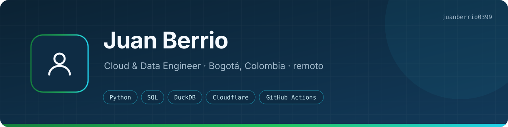
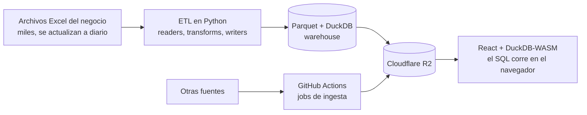

<a href="README.md">English</a> · <b>Español</b>

<b>Qué hago:</b> soy ingeniero de datos en Bogotá, con más de 6 años en ETL, warehouses analíticos y BI. Los pipelines que tengo en producción manejan más de 36M de registros que salen de más de 13K archivos Excel. 
<b>Cómo trabajo:</b> tomo un proceso que la gente hace a mano en Excel, lo vuelvo un pipeline en Python que escribe Parquet y sirvo el resultado desde la nube por casi $0. 
<a href="https://juanberrio0399.github.io">Portafolio</a> · <a href="https://www.linkedin.com/in/juanberrioo">LinkedIn</a> · <a href="mailto:juandyb99@gmail.com">juandyb99@gmail.com</a> · Bogotá, Colombia · remoto (GMT-5)

---

## Sobre mí

Casi todo lo que he construido empezó como la hoja de cálculo de alguien. Un equipo descarga archivos todos los días, copia columnas, cruza dos reportes a mano y espera que no se le haya escapado nada. Yo convierto eso en un pipeline que lee los archivos, los valida y guarda un histórico limpio, y encima le pongo un tablero que se actualiza solo.

Me gusta hacerlo con la menor infraestructura posible: el cómputo donde ya están los datos, el almacenamiento en buckets de objetos y las consultas corriendo en el navegador. Algunos de estos sistemas no cuestan nada de hosting.

También trabajo con LLMs todos los días, tanto para construir herramientas (uno de mis repos públicos es un asistente RAG) como para automatizar mi propio trabajo. Ahora estoy estudiando AWS e Ingeniería de Sistemas, con la mira puesta en arquitectura de soluciones cloud.

Estoy abierto a roles remotos de Data / Cloud Engineering.

## Cómo funciona un proyecto típico mío

Esta es la forma de DataForge, la plataforma que manejo en el trabajo. El cliente y los datos son privados; la arquitectura no.

Solo se reprocesan los archivos que cambiaron, así que una corrida toma minutos y no reconstruye años de histórico. El tablero no tiene backend: Cloudflare Pages le entrega los Parquet al navegador y DuckDB-WASM los consulta ahí mismo.

## Proyectos destacados

Casi todo mi trabajo es privado porque corre sobre datos de una empresa. Los write-ups con arquitectura y resultados están en mi **[sitio de portafolio](https://juanberrio0399.github.io)**.

### DataForge Cloud: plataforma de analítica serverless

*En producción.* Un worker ETL local publica Parquet en Cloudflare R2 y un tablero en Cloudflare Pages (React + DuckDB-WASM) lo consulta directo en el navegador. Sin backend y sin base de datos que mantener, con ~$0 de infraestructura. Un segundo camino, todo en la nube, ingiere otras fuentes con GitHub Actions.

`Cloudflare R2/Pages` · `React` · `DuckDB-WASM` · `GitHub Actions` · `Power Automate`

→ [Ver el caso de estudio](https://juanberrio0399.github.io/case-study-dataforge.html)

### DataForge: pipeline ETL y warehouse analítico

*En producción.* ETL en Python por capas (`readers → transforms → writers`) que ingiere de forma incremental los Excel del negocio a Parquet y expone un warehouse en DuckDB. Concilia impuestos de aduana guía por guía cruzando 5 fuentes. Se corre con un clic y antes de arrancar revisa que el equipo esté listo.

`Python` · `Pandas` · `DuckDB` · `Parquet`

### UGPP Shield Pro: app web de cumplimiento para líderes financieros

*Lista, sin lanzar.* Una app web para CFOs que cruza la nómina contra la seguridad social dentro del navegador, así que los datos no salen del equipo. Hecha para Cloudflare Pages; el lanzamiento está pendiente.

`JavaScript` · `Vite` · `Cloudflare Pages`

### Automatización de portal logístico (RPA)

*En uso.* Un bot en Playwright que sube y descarga documentos en un portal logístico de e-commerce, emparejando registros por reglas de negocio. Confirma cada carga con la respuesta de red del propio portal, no da por hecho que funcionó.

`Python` · `Playwright`

### [Serverless RAG Assistant](https://github.com/juanberrio0399/serverless-rag-assistant)

*Público, en vivo.* Preguntas sobre tus propios documentos. Un solo Worker de Cloudflare con Workers AI, Vectorize, D1 y Workflows: recuperación con reranking, citas, defensas contra prompt injection y demo en vivo.

`Cloudflare Workers` · `Workers AI` · `Vectorize` · `D1`

### [Dockerized Data Tool](https://github.com/juanberrio0399/dockerized-data-tool)

*Público.* Una CLI pequeña de CSV publicada con una cadena de suministro de contenedores endurecida: imágenes para dos arquitecturas construidas en runners nativos, bloqueo con Trivy, SBOM y procedencia SLSA. Lo que descargas es exactamente lo que se escaneó.

`Docker` · `GitHub Actions` · `Trivy` · `SLSA`

### Hearthwood: un juego de Roblox

*Proyecto personal, en desarrollo.* Un juego de supervivencia que estoy construyendo desde cero y por fases, con diseño cliente-servidor: 48 servicios en el servidor y 19 controladores en el cliente. Es donde practico diseño de sistemas por fuera de los datos.

`Luau` · `Roblox` · `Rojo`

## Dónde seguir mirando

| Dónde | Qué vas a encontrar |
|---|---|
| [juanberrio0399.github.io](https://juanberrio0399.github.io) | Portafolio, hoja de vida (ES/EN), el caso de estudio de DataForge y un playground de SQL que corre DuckDB-WASM en tu navegador ([código](https://github.com/juanberrio0399/juanberrio0399.github.io)) |
| [serverless-rag-assistant](https://github.com/juanberrio0399/serverless-rag-assistant) | IA en el borde de Cloudflare, con pruebas que corren dentro del runtime de Workers |
| [dockerized-data-tool](https://github.com/juanberrio0399/dockerized-data-tool) | Cadena de suministro de contenedores: escaneo, SBOM, procedencia, dos plataformas |

## Stack técnico

**Datos:** Python (Pandas) · SQL · DuckDB · Parquet · ETL e ingesta incremental · modelado dimensional 
**Cloud y DevOps:** Cloudflare (Workers, R2, Pages, D1, Vectorize) · GitHub Actions · Terraform · Docker · Git · AWS (aprendiendo) 
**BI y web:** Power BI · Power Query · React · TypeScript · DuckDB-WASM 
**Automatización e IA:** Playwright (RPA) · Power Automate · integración de LLMs · RAG · prompt engineering

## Qué estoy aprendiendo

Terminé **AWS Cloud Practitioner Essentials** (AWS Training & Certification, junio de 2026) y estoy preparando el examen de Cloud Practitioner. Lo que sigue: AWS Solutions Architect, dbt y llevar el inglés a B2. También estudio Ingeniería de Sistemas en la Corporación Universitaria Americana.

---

Juan Berrio · [juandyb99@gmail.com](mailto:juandyb99@gmail.com) · [LinkedIn](https://www.linkedin.com/in/juanberrioo)
