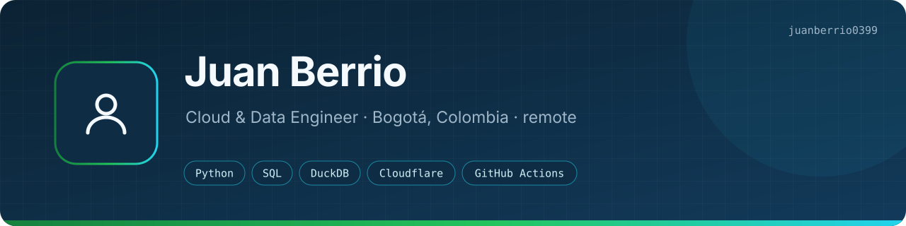
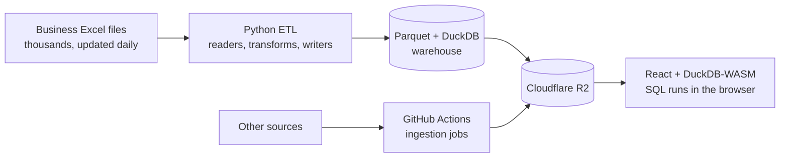

<b>English</b> · <a href="README.es.md">Español</a>

<b>What I do:</b> I'm a data engineer in Bogotá with 6+ years in ETL, analytical warehouses and BI. My pipelines in production handle 36M+ records from 13K+ Excel files.

<b>How I work:</b> I take a process people run by hand in Excel, turn it into a Python pipeline that writes Parquet, and serve the result from the cloud for close to $0.

<a href="https://juanberrio0399.github.io">Portfolio</a> · <a href="https://www.linkedin.com/in/juanberrioo">LinkedIn</a> · <a href="mailto:juandyb99@gmail.com">juandyb99@gmail.com</a> · Bogotá, Colombia · remote (GMT-5)

---

## About me

Most of what I've built started as somebody's spreadsheet. A team downloads files every day, copies columns, crosses two reports by hand and hopes nothing was missed. I turn that into a pipeline that reads the files, checks them and keeps a clean history, and then I put a dashboard on top that updates itself.

I like doing it with as little infrastructure as possible: compute where the data already is, storage in object buckets, and queries that run in the browser. Some of these systems cost nothing to host.

I also work with LLMs day to day, both to build tools (one of my public repos is a RAG assistant) and to automate my own work. Right now I'm studying AWS and Systems Engineering, heading toward cloud solutions architecture.

I'm open to remote Data / Cloud Engineering roles.

## How a typical project of mine works

This is the shape of DataForge, the platform I run at work. The client and the data are private; the architecture isn't.

Only the files that changed get reprocessed, so a run takes minutes instead of rebuilding years of history. The dashboard has no backend: Cloudflare Pages hands the Parquet files to the browser and DuckDB-WASM queries them there.

## Featured projects

Most of my work is private because it runs on a company's data. The write-ups with architecture and results are on my **[portfolio site](https://juanberrio0399.github.io)**.

### DataForge Cloud: serverless analytics platform

*In production.* A local ETL worker publishes Parquet to Cloudflare R2, and a dashboard on Cloudflare Pages (React + DuckDB-WASM) queries it straight in the browser. No backend and no database to maintain, ~$0 in infrastructure. A second, fully cloud path ingests other sources with GitHub Actions.

`Cloudflare R2/Pages` · `React` · `DuckDB-WASM` · `GitHub Actions` · `Power Automate`

→ [Read the case study](https://juanberrio0399.github.io/case-study-dataforge.html)

### DataForge: ETL pipeline and analytical warehouse

*In production.* Layered Python ETL (`readers → transforms → writers`) that ingests business Excel files incrementally into Parquet and exposes a DuckDB warehouse. It reconciles customs taxes package by package across 5 sources. You run it with one click, and it checks the machine before it starts.

`Python` · `Pandas` · `DuckDB` · `Parquet`

### UGPP Shield Pro: compliance web app for finance leads

*Built, not launched.* A web app for CFOs that crosses payroll against social-security filings in the browser, so the data never leaves the device. Built for Cloudflare Pages; launch is pending.

`JavaScript` · `Vite` · `Cloudflare Pages`

### Logistics portal automation (RPA)

*In use.* A Playwright bot that uploads and downloads documents in an e-commerce logistics portal, matching records by business rules. It confirms each upload from the portal's own network response instead of assuming it worked.

`Python` · `Playwright`

### [Serverless RAG Assistant](https://github.com/juanberrio0399/serverless-rag-assistant)

*Public, live.* Ask questions about your own documents. One Cloudflare Worker with Workers AI, Vectorize, D1 and Workflows: reranked retrieval, citations, prompt-injection defences and a live demo.

`Cloudflare Workers` · `Workers AI` · `Vectorize` · `D1`

### [Dockerized Data Tool](https://github.com/juanberrio0399/dockerized-data-tool)

*Public.* A small CSV CLI shipped through a hardened container supply chain: multi-arch images built on native runners, a Trivy gate, SBOM and SLSA provenance. What you pull is exactly what was scanned.

`Docker` · `GitHub Actions` · `Trivy` · `SLSA`

### Hearthwood: a Roblox game

*Side project, in development.* A survival game I'm building from scratch, by phases, with a client-server design: 48 server services and 19 client controllers. It's where I practice systems design outside of data.

`Luau` · `Roblox` · `Rojo`

## Where to look next

| Where | What you'll find |
|---|---|
| [juanberrio0399.github.io](https://juanberrio0399.github.io) | Portfolio, CV (EN/ES), the DataForge case study and a SQL playground that runs DuckDB-WASM in your browser ([source](https://github.com/juanberrio0399/juanberrio0399.github.io)) |
| [serverless-rag-assistant](https://github.com/juanberrio0399/serverless-rag-assistant) | AI on Cloudflare's edge, with tests that run inside the Workers runtime |
| [dockerized-data-tool](https://github.com/juanberrio0399/dockerized-data-tool) | Container supply chain: scan, SBOM, provenance, two platforms |

## Tech stack

**Data:** Python (Pandas) · SQL · DuckDB · Parquet · ETL and incremental ingestion · dimensional modeling 
**Cloud and DevOps:** Cloudflare (Workers, R2, Pages, D1, Vectorize) · GitHub Actions · Terraform · Docker · Git · AWS (learning) 
**BI and web:** Power BI · Power Query · React · TypeScript · DuckDB-WASM 
**Automation and AI:** Playwright (RPA) · Power Automate · LLM integration · RAG · prompt engineering

## What I'm learning

I finished **AWS Cloud Practitioner Essentials** (AWS Training & Certification, June 2026) and I'm preparing for the Cloud Practitioner exam. Next on the list: AWS Solutions Architect, dbt and English up to B2. I'm also in the Systems Engineering program at Corporación Universitaria Americana.

---

Juan Berrio · [juandyb99@gmail.com](mailto:juandyb99@gmail.com) · [LinkedIn](https://www.linkedin.com/in/juanberrioo)
